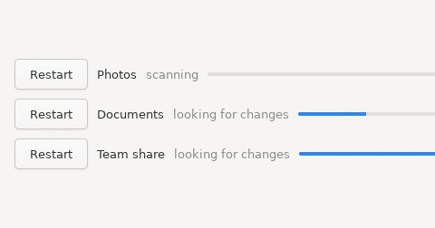
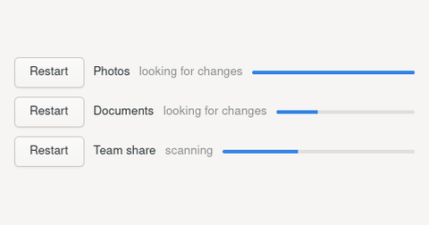
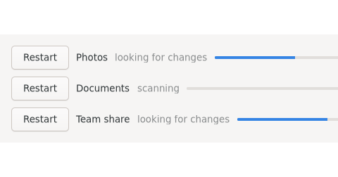
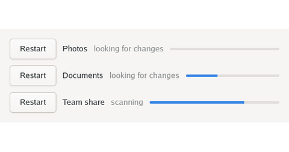
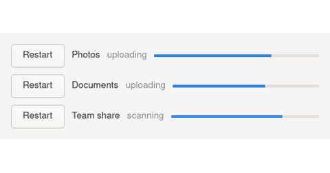
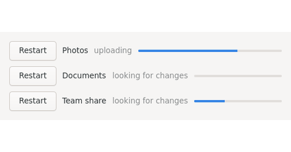

# vero

Go backend, native frontends 

vero is a way to build a desktop app once as a Go program on your Mac and ship it to macOS, Windows,
Linux and the BSDs, with native windows and controls on each.

## What it is

You write the app's logic as a Go program, called the **worker**. It holds
the app's state and does the real work. On each system, a small native
front end draws the window: SwiftUI on the Mac, GTK 4 on Linux and the
BSDs, WPF on Windows. The front end starts the worker and talks to it over
a pipe in JSON. When the worker's state changes, every window redraws.

The Go worker cross-compiles from a Mac to every system Go supports. vero builds, tests and releases everything
from one machine:

- `vero new` writes the worker and a starter front end for each system.
- `vero gen` writes a typed binding for each front end from the worker's
  Go types, so the windows and the worker cannot drift apart.
- `vero ship` installs the app on each system the way a user would, in
  containers and virtual machines, plays a scripted test, records a GIF of
  each window, and publishes installers, package repositories and an
  install page with built-in updates.

[How vero works](docs/how-vero-works.md) explains the pieces in more depth.

## Ten minutes to a running app

You need a Mac with Apple silicon, [Homebrew](https://brew.sh), Go
(`brew install go`) and Xcode from the App Store.

**1. Install vero.**

```bash
GOBIN=$(brew --prefix)/bin go install github.com/imclaren/vero/cmd/vero@latest
vero setup
```

`vero setup` uses Homebrew to install the tools that building and testing
on other systems need, such as Docker and qemu. It asks for an Apple ID so
that it can notarise Mac builds, and it is safe to run again. You can skip
it for now and still build and run on the Mac.

**2. Make an app.**

```bash
vero new jotter
cd jotter
```

This writes a Go module with an example worker in `cmd/worker`, a SwiftUI
app in `macos/`, a GTK app in `gtk/`, a WPF app in `windows/`, and a
`vero-app.toml` that describes the app. 

**3. Run it on the Mac.**

```bash
cd macos && ./build.sh
VERO_PROFILE=dev ./.build/debug/Jotter
```

A window opens showing the worker's state, with a button for each request
the worker handles. `VERO_PROFILE=dev` keeps this copy's files and settings
apart from any copy you later install for real. Always set it when running
a development build.

**4. Change the worker.**

Open `cmd/worker/main.go`. The state is the `Status` struct, and each
`vero.Update` or `vero.UpdateWith` call is a request the window can send.
Add a field to the state and a handler that changes it:

```go
type Status struct {
    Jobs    []Job  `json:"jobs"`
    Working bool   `json:"working"`
    Since   string `json:"since"`
    Note    string `json:"note"`    // new
}

type SetNote struct {
    Text string `json:"text"`
}

vero.UpdateWith(state, "setNote", func(s *Status, req SetNote) error {
    s.Note = req.Text
    return nil
})
```

Then regenerate the bindings and rebuild:

```bash
cd ..
vero gen
cd macos && ./build.sh
```

The window now shows the new field and offers the new request. The same
change reaches the GTK and WPF front ends without any further work, because
`vero gen` wrote their bindings too.

**5. Ship it.**

```bash
vero ship --plan      # which systems this Mac can build and test
vero ship --no-release
```

The second command installs the app on every system this Mac can run,
plays the test in `vero-app.toml`, and records each window. Results are at
`~/.cache/vero/test-results/index.html`. When they look right, release:

```bash
vero ship --notes "First release."
```

That writes a complete install site to `dist/site`. Copy it to any static
host, or pass `--upload user@host:/path`. Later, `vero upgrade` moves the
app to a newer vero.

## Where it runs

The GTK app is one app, unchanged on every operating system where it runs.

| | |
|:---:|:---:|
| **macOS**<br><a href="example/menubar-app"></a><br>SwiftUI, on the Mac itself. | **Windows**<br><a href="example/wpf-app"></a><br>WPF, in a Windows 11 virtual machine. |
| **Linux**<br><a href="example/gtk-app"></a><br>GTK 4, in a container, and on Chromebooks. | **FreeBSD**<br><a href="example/gtk-app"></a><br>The same GTK app, in a virtual machine. |
| **OpenBSD**<br><a href="example/gtk-app"></a><br>The same GTK app, in a virtual machine. | **NetBSD**<br><a href="example/gtk-app"></a><br>The same GTK app, in a virtual machine. |
| **DragonFly**<br><a href="example/gtk-app"></a><br>The same GTK app, emulated on x86. | **illumos**<br><a href="example/gtk-app"></a><br>The same GTK app, on OpenIndiana. |

Android, iOS, the browser, WASI and Plan 9 also build and run. Their
examples live in [the lab](docs/lab.md), because `vero ship` does not
automatically test or release them.

## Where to go next

The walkthrough above continues, with the same app, on three pages. Each
is numbered steps with the command to run and what you should see:

1. [Build the app](docs/build-the-app.md). A real screen on each system,
   a sign-in kept in the keychain, and a check that the worker builds
   everywhere.
2. [Test the app](docs/test-the-app.md). The app installed and driven by
   a script on Debian, FreeBSD and Windows, from the Mac.
3. [Ship the app](docs/ship-the-app.md). The first release, the site,
   updates, signing, and Homebrew.

[How vero works](docs/how-vero-works.md) explains the pieces and ends
with a glossary, for when you want to know why. References:
the [Go reference](https://pkg.go.dev/github.com/imclaren/vero), the
[kit](kit/README.md), and [packaging for each system](cmd/vero-repo/README.md).

If a coding agent works on your app, it reads [AGENTS.md](AGENTS.md),
which `vero new` copies into every app.

vero is released under the [MIT licence](LICENSE).
