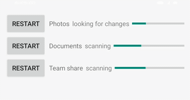
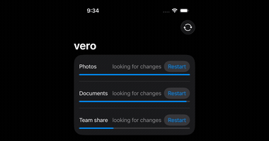
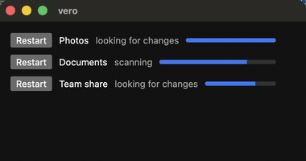
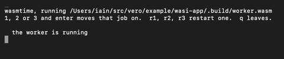
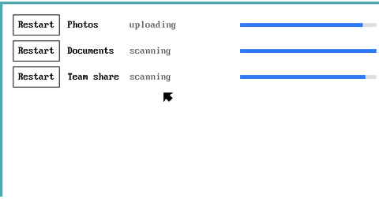

# The lab

vero runs on more than the desktop systems to which `vero ship` releases.
This page shows the rest, with what each can and cannot do. `vero add
mobile`, `vero add web`, `vero add wasi` and `vero add plan9` write these
front ends, `vero release` packages them, and `vero ship` neither tests nor
records them.

| System | Example | How it runs |
|---|:---:|---|
| **Android** |  | Kotlin, with the worker shipped as a native library and no Gradle. [`setup-android.sh`](../scripts/setup-android.sh) installs the SDK, a JDK and Kotlin, which take about 5GB, and [`run-android.sh`](../scripts/run-android.sh) runs it in the emulator. vero signs the `.apk` with a keystore that it makes, or with the one that `VERO_ANDROID_KEYSTORE` names. Never lose it, since Android installs an update only when the same key signed it. |
| **iOS** |  | SwiftUI, in the Simulator, by [`run-ios.sh`](../scripts/run-ios.sh). An iOS app may not start a program, so the worker is compiled into the app and runs on a goroutine. An app reaches phones only through the App Store, with `VERO_IOS_IDENTITY` and `VERO_IOS_PROFILE` set. |
| **A browser** |  | The front end and the worker in one wasm module, since a page may not start a program either. [`run-web.sh`](../scripts/run-web.sh) builds and opens it. |
| **WASI** |  | A Go front end that starts `wasmtime`, which runs `worker.wasm`. The front end has to be Go, since the other bindings would ask the worker to start a second copy of itself, which a sandbox forbids. The worker answers one request at a time and does nothing in between. |
| **Plan 9** |  | libdraw in a rio window, in an emulated 9front VM, by [`run-plan9.sh`](../scripts/run-plan9.sh), whose `--test` runs vero's tests there. The Go libdraw did not build for Plan 9 until [9fans/go#147](https://github.com/9fans/go/pull/147), so the example pins vero's fork, which carries that fix. |
| **Solaris** | None | The worker builds, and nothing runs. Oracle Solaris needs an Oracle account to download, and its repository ships GTK 3, not GTK 4. |
| **AIX** | None | The worker builds, and nothing runs. There is no public AIX media, so qemu's `pseries` has nothing to boot. |

On iOS and in a browser, `vero add` moves the worker's code into
`internal/worker`, which the app calls, and leaves `cmd/worker` as a few
lines that start it. That works for a worker whose `main` makes a
`vero.WorkerOptions`, calls `vero.NewWorker` and ends with `Serve`. For
any other worker, or with `--keep-worker`, it writes a placeholder and a
note that says what to call.

## Every target that Go builds

The worker cross-compiles to every one of these. [`build-all.sh`](../scripts/build-all.sh)
builds those in bold, other than `android/arm64`, `ios/arm64` and
`js/wasm`, which their examples' `build.sh` build. The targets marked †
need a C toolchain, which is an NDK or the Simulator SDK. A test in
[docs_test.go](../docs_test.go) fails when Go adds a target that this
table lacks.

| System | Targets |
|---|---|
| macOS | **`darwin/amd64`**, **`darwin/arm64`** |
| Windows | `windows/386`, **`windows/amd64`**, **`windows/arm64`** |
| Linux | `linux/386`, **`linux/amd64`**, `linux/arm`, **`linux/arm64`**, `linux/loong64`, `linux/mips`, `linux/mips64`, `linux/mips64le`, `linux/mipsle`, `linux/ppc64`, `linux/ppc64le`, `linux/riscv64`, `linux/s390x` |
| FreeBSD | `freebsd/386`, **`freebsd/amd64`**, `freebsd/arm`, **`freebsd/arm64`** |
| OpenBSD | `openbsd/386`, **`openbsd/amd64`**, `openbsd/arm`, **`openbsd/arm64`**, `openbsd/ppc64`, `openbsd/riscv64` |
| NetBSD | `netbsd/386`, **`netbsd/amd64`**, `netbsd/arm`, **`netbsd/arm64`** |
| DragonFly | **`dragonfly/amd64`** |
| illumos | **`illumos/amd64`** |
| Android | `android/386`†, `android/amd64`†, `android/arm`†, **`android/arm64`** |
| iOS | `ios/amd64`†, **`ios/arm64`** |
| A browser | **`js/wasm`** |
| WASI | **`wasip1/wasm`** |
| Plan 9 | `plan9/386`, **`plan9/amd64`**, `plan9/arm` |
| Solaris | **`solaris/amd64`** |
| AIX | **`aix/ppc64`** |
